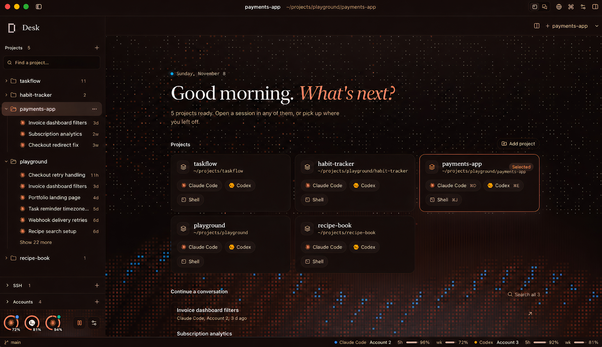
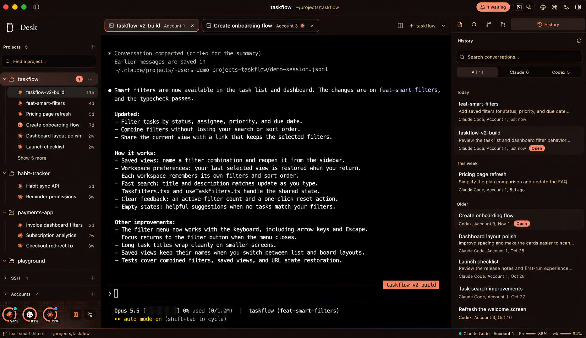
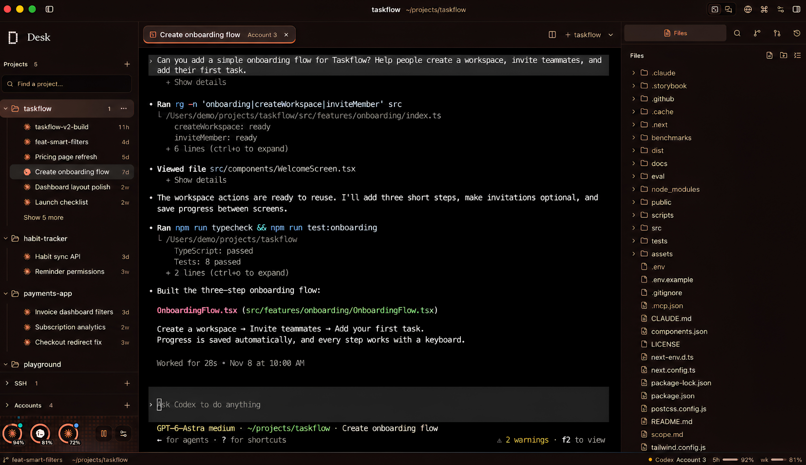
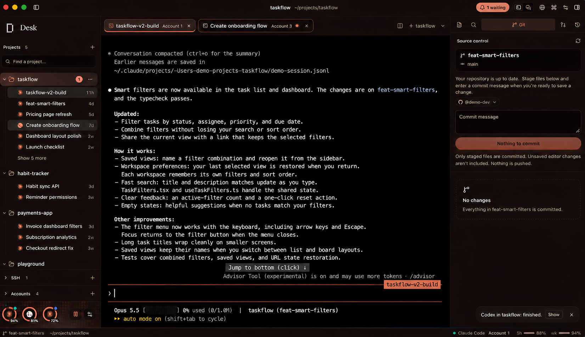
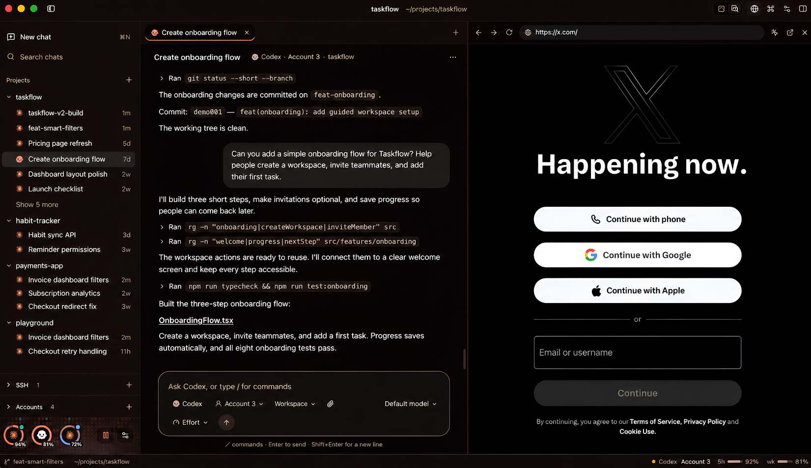
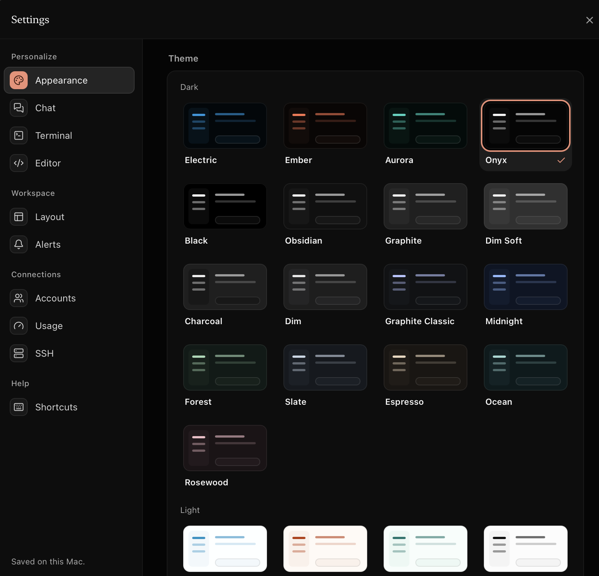
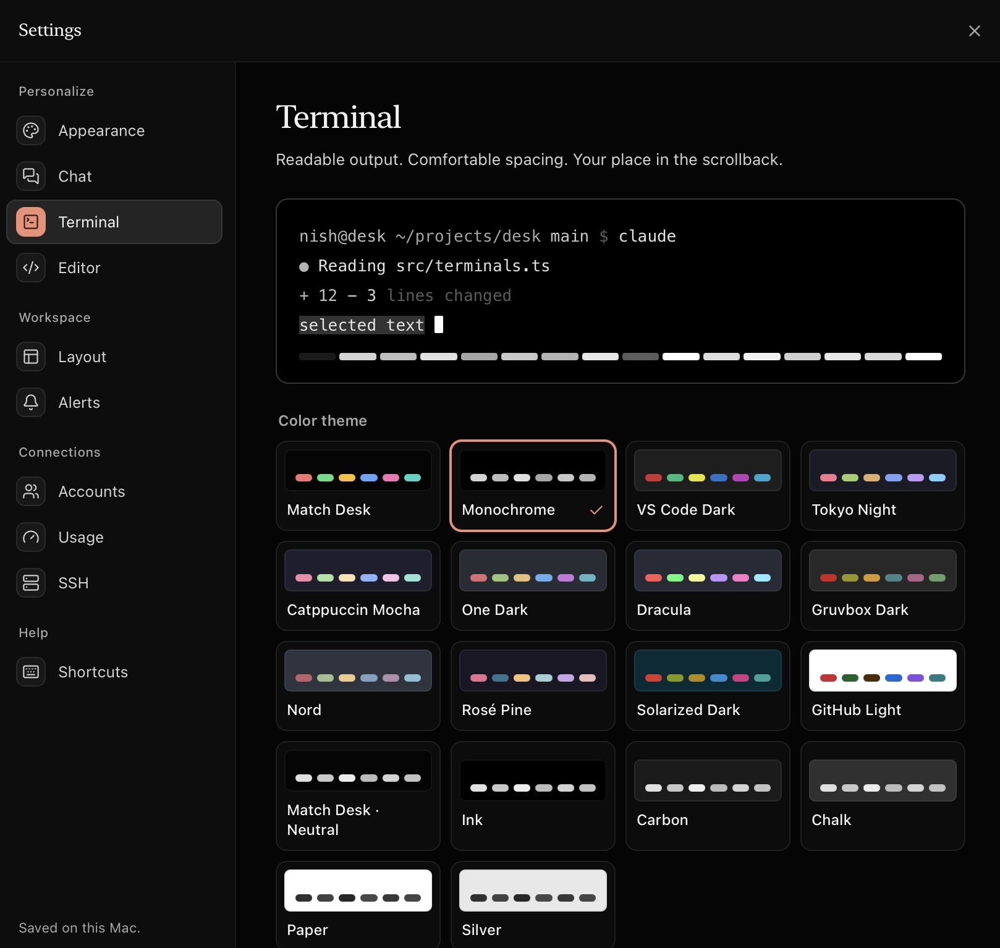
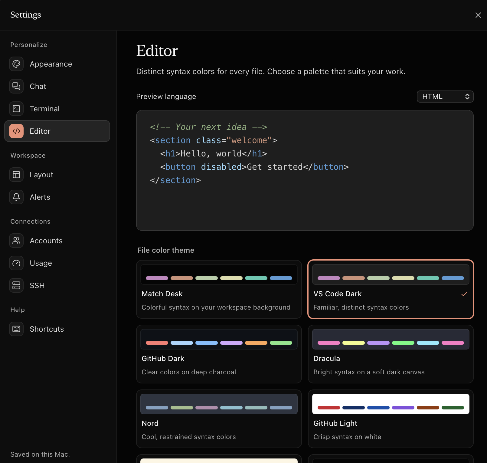
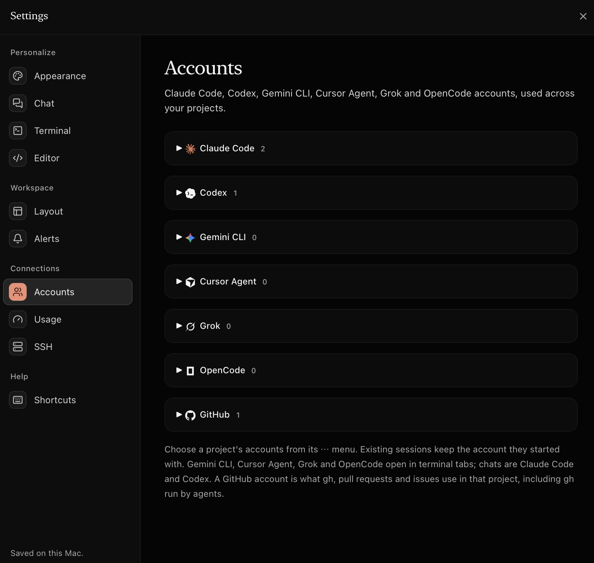

<div align="center">


# Desk

**Every agent. One desk.**

A calm macOS workspace for Claude Code, Codex and friends.<br>
Projects, terminals, files, git and chat in one window, and the right account for every project.

[**Download for macOS**](https://github.com/s-nish/desk/releases/latest/download/Desk.dmg) · [Website](https://github.com/s-nish/desk/tree/main/site) · [Report an issue](https://github.com/s-nish/desk/issues)


<br>

<picture>
  <source media="(prefers-color-scheme: light)" srcset="site/assets/shots/home-light.png">
  
</picture>

<sub>The screenshot follows your GitHub theme. Switch between light and dark to see both.</sub>

</div>

<br>

## Runs the agents you already use

<table>
  <tr>
    <td align="center" width="14%"><br><sub><b>Claude Code</b></sub></td>
    <td align="center" width="14%"><br><sub><b>Codex</b></sub></td>
    <td align="center" width="14%"><br><sub><b>Gemini CLI</b></sub></td>
    <td align="center" width="14%"><br><sub><b>Cursor Agent</b></sub></td>
    <td align="center" width="14%"><br><sub><b>Grok</b></sub></td>
    <td align="center" width="14%"><br><sub><b>OpenCode</b></sub></td>
    <td align="center" width="14%"><br><sub><b>GitHub</b></sub></td>
  </tr>
</table>

Desk runs the command-line tools you already have installed and signed in. It never stores or sends your tokens, unless you paste one into Settings ▸ Sandboxes so an agent can sign in inside a sandbox; that token is kept in a file only you can read and goes only to that sandbox.

## Highlights

|  |  |
| --- | --- |
| **The right account, every time** | Pick a Claude Code, Codex and GitHub account per project. Every tab opens already signed in as the right you. |
| **Terminal or chat** | Run agents in real terminals, or as a conversation with attachments, permission modes and a worktree per chat. |
| **Files beside the session** | Browse and edit with syntax highlighting. Preview images, PDFs and CSV. Unsaved buffers survive a restart. |
| **Review before you ship** | Stage, commit and open pull requests. Comment on a diff line and send it to the agent. Desk never pushes on its own. |
| **A browser for your dev server** | Dock it next to the agent. Design mode picks an element and hands it over as context. |
| **Limits at a glance** | Usage rings for every account: blue, cantaloupe from 80%, red at the limit. |
| **Quit without fear** | Open files, unsaved buffers, splits and tab order all come back. |

## Tour

<table>
  <tr>
    <td width="50%"><br><sub><b>Terminals and history.</b> Every past conversation, one click away.</sub></td>
    <td width="50%"><br><sub><b>Files.</b> The tree and editor stay next to the session.</sub></td>
  </tr>
  <tr>
    <td width="50%"><br><sub><b>Git.</b> Review, commit and open PRs with the project's GitHub account.</sub></td>
    <td width="50%"><br><sub><b>Chat and browser.</b> A conversation view with a browser docked beside it.</sub></td>
  </tr>
</table>

## Make it yours

<table>
  <tr>
    <td width="50%"><br><sub><b>Appearance.</b> 24 app themes, dark and light.</sub></td>
    <td width="50%"><br><sub><b>Terminal.</b> 18 palettes with a live preview.</sub></td>
  </tr>
  <tr>
    <td width="50%"><br><sub><b>Editor.</b> Syntax colours, previewed per language.</sub></td>
    <td width="50%"><br><sub><b>Accounts.</b> Seven tools, as many accounts as you need.</sub></td>
  </tr>
</table>

Desk opens in **Electric**: Midnight `#02070A`, Electric Blue `#0297DE` and a touch of Cantaloupe `#FC734D`, with serif headings, pill buttons and an animated pixel-wave backdrop on Home. The four **pixel themes** are Electric, Electric Light, Ember and Aurora. Turn the animation off from the sidebar or **Settings ▸ Appearance**. It always stays still when Reduce motion is on.

## Install

**From Terminal:**

```sh
curl -fL https://github.com/s-nish/desk/releases/latest/download/Desk.dmg -o ~/Downloads/Desk.dmg && open ~/Downloads/Desk.dmg
```

**Or by hand:** download [**Desk.dmg**](https://github.com/s-nish/desk/releases/latest/download/Desk.dmg) from the latest release.

Then drag Desk to Applications, and install and sign in to the agents you use, such as `claude` or `codex`. Desk picks them up on launch.

> [!TIP]
> Desk isn't notarized yet. If you downloaded it in a browser, macOS asks on first launch: open **System Settings ▸ Privacy & Security** and choose **Open Anyway**. The Terminal command above skips that prompt.

> [!NOTE]
> The release is built for Apple silicon. On an Intel Mac, [build from source](#develop).

## How accounts work

An account is a config folder. Desk sets the right folder for every terminal and chat it opens.

| Tool        | Variable            | Default folder | Extra accounts            |
| ----------- | ------------------- | -------------- | ------------------------- |
| Claude Code | `CLAUDE_CONFIG_DIR` | `~/.claude`    | `~/.claude-<name>`        |
| Codex       | `CODEX_HOME`        | `~/.codex`     | `~/.codex-<name>`         |
| GitHub      | `GH_CONFIG_DIR`     | `~/.config/gh` | `~/.config/gh-<name>`     |

Desk finds existing folders on launch. **Add account** creates a new folder and runs the tool's own sign-in inside it. To show which email is signed in, Desk reads that one field locally: `oauthAccount.emailAddress` from `.claude.json`, and only the `email` claim from Codex's `auth.json`.

> [!IMPORTANT]
> **Pull requests are untrusted code.** When you check out or review someone else's pull request, Desk asks first and marks the worktree untrusted. Agents there start without the branch's own settings, hooks and MCP servers (`--setting-sources user --strict-mcp-config`), in plan mode for Claude Code and a read-only sandbox for Codex.

## Shortcuts

| Keys            | Action                         | Keys            | Action                        |
| --------------- | ------------------------------ | --------------- | ----------------------------- |
| <kbd>⌘</kbd> <kbd>⇧</kbd> <kbd>P</kbd> | Command palette | <kbd>⌘</kbd> <kbd>P</kbd> | Open file in project |
| <kbd>⌘</kbd> <kbd>⇧</kbd> <kbd>F</kbd> | Search and replace | <kbd>⌘</kbd> <kbd>O</kbd> | Add project folder |
| <kbd>⌘</kbd> <kbd>\\</kbd> | Toggle split panes | <kbd>⌘</kbd> <kbd>B</kbd> / <kbd>⌘</kbd> <kbd>⇧</kbd> <kbd>B</kbd> | Toggle projects / files |
| <kbd>⌘</kbd> <kbd>T</kbd> | New Claude Code tab | <kbd>⌘</kbd> <kbd>K</kbd> | Clear terminal |
| <kbd>⌘</kbd> <kbd>W</kbd> | Close tab | <kbd>⌘</kbd> <kbd>1</kbd>–<kbd>9</kbd> | Switch tabs |
| <kbd>⌘</kbd> <kbd>S</kbd> | Save file | <kbd>⌥</kbd> <kbd>⌘</kbd> <kbd>↑</kbd> / <kbd>↓</kbd> | Switch projects |
| <kbd>⌘</kbd> <kbd>,</kbd> | Settings | <kbd>⇧</kbd> <kbd>Enter</kbd> | Newline in Claude Code / Codex |

Drop folders on the window to add projects. Drop files on a terminal to paste their paths.

<details>
<summary><b>More details</b>: workspace, terminal, editor and appearance</summary>

<br>

**Workspace**

- **Home** appears whenever nothing is open: every project as a card with one-click Claude Code, Codex and Shell sessions, plus recent conversations.
- **Recovery** restores open files, unsaved buffers, tab selection and split layout. Changed files on disk show a conflict before overwrite. Terminal tabs restore as restart cards.
- **Tab order:** drag tabs to reorder, or focus one and use <kbd>⌥</kbd> <kbd>⇧</kbd> <kbd>←</kbd> / <kbd>→</kbd>. <kbd>Esc</kbd> cancels a drag.
- **Split panes:** click a pane to target it, drag the divider or use its arrow keys to resize.
- **Source control** covers the repository root, including when the project is a subfolder. Unsaved editor buffers are not included in commits.
- **Project search** respects ignore files and skips binary files and build folders. Replace previews every change and skips dirty buffers.

**Terminal**

- 12 original palettes plus 6 neutral ones, individual colour overrides and smooth scrolling. Text contrast is corrected to 7:1 where xterm supports it.
- 20,000 lines of history. Incoming output never moves you to the bottom; use **Latest output** or <kbd>⇧</kbd> <kbd>End</kbd> to return.

**Editor**

- Eight file colour themes: Match Desk, VS Code Dark, GitHub Dark, Dracula, Nord, GitHub Light, Solarized Light and Monochrome.
- Syntax highlighting follows filenames, with lazy-loaded support for many languages.

**Appearance**

- 24 themes, or match your system. Comfortable or compact spacing, panel visibility and optional account colours.
- Preferences are saved on this Mac.

</details>

## Develop

Requires Rust ([rustup](https://rustup.rs)) and Node 20+.

```sh
npm install
npm run tauri dev           # live-reloading dev build
npm run tauri build         # release Desk.app and .dmg in src-tauri/target/release/bundle
cd src-tauri && cargo test  # backend tests
```

| Path | What lives there |
| --- | --- |
| `src-tauri/src` | Rust backend: `pty.rs` terminals, `accounts.rs` account discovery, `files.rs` tree and editor I/O, `gh.rs` GitHub |
| `src` | React UI. `terminals.ts` and `editors.ts` keep xterm.js and CodeMirror alive outside React, so sessions survive tab and project switches |
| `site` | The landing page: plain HTML, CSS and JS |

App state is saved to `~/Library/Application Support/Desk/state.json`.

<details>
<summary><b>Validation</b></summary>

<br>

```sh
npm run build
npm run test:backend
npm run dev -- --host 127.0.0.1 --port 1421
# In another terminal (uses an installed Chrome, isolated data, mocked IPC):
npm run test:ui
npm run test:appearance
```

Set `CHROME_PATH` to use a different Chrome, or `DESK_TEST_URL` for a different dev-server address. The UI smoke test covers restoration, split panes, search and replace, Git controls, the command palette and quit-time persistence. Appearance checks cover theme contrast, system theme changes, terminal palettes, scrollback and alternate-screen navigation.

</details>

## License

[MIT](LICENSE)

<sub>Claude, Codex, Gemini, Cursor, Grok, OpenCode and GitHub are trademarks of their owners. Desk is independent and not affiliated with them. Logos from [Lobe Icons](https://lobehub.com/icons) (MIT).</sub>
